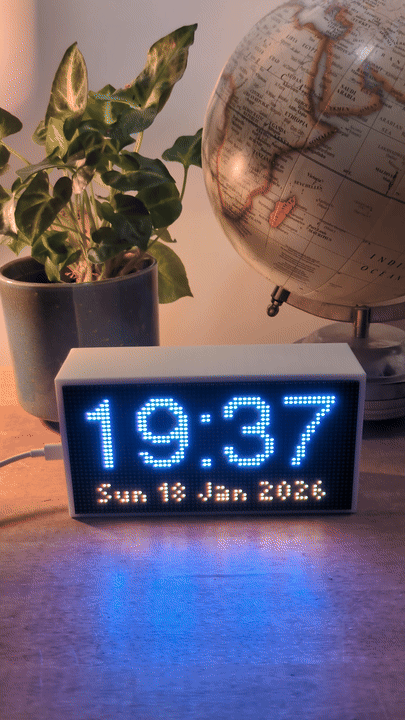

# Lynx

Lynx is a smart LED display designed to show real-time information such as the time, weather, air quality, city bike availability, and public transport schedules.



## Hardware

- **Adafruit Matrix Portal S3** (ESP32-S3–based controller designed to drive RGB LED matrix displays)
- **RGB LED matrix panel (64×32)**
- **3D-printed case**

## Screens

- Current time and date
- Current weather and air quality
- Weather recap for today and tomorrow
- City bike availability at a selected station (Lyon’s Vélo’v)
- Next metro arrival times and service alerts (Lyon)

## APIs

- Weather and air quality: [OpenMeteo](https://open-meteo.com)
- City bike and transport: [data.grandlyon](https://data.grandlyon.com)

## Configuration

Use **PlatformIO** to open the project. Then create a configuration file at:

```
data/config.json
```

The file must contain the following properties:

```yml
wifi_ssid:
  type: string
  description: Wi-Fi network SSID

wifi_password:
  type: string
  description: Wi-Fi network password

brightness:
  type: float
  description: Display brightness (range: 0.0 to 1.0)

screen_interval:
  type: integer
  description: Time interval in milliseconds between screen changes

latitude:
  type: float
  description: Latitude used for weather and air quality data

longitude:
  type: float
  description: Longitude used for weather and air quality data

gmt_offset:
  type: integer
  description: GMT offset in seconds

dst_offset:
  type: integer
  description: Daylight saving time offset in seconds

api_bike_station_id:
  type: integer
  description: ID of the city bike station to monitor

api_transport_stop_id_1:
  type: integer
  description: First public transport stop ID

api_transport_stop_id_2:
  type: integer
  description: Second public transport stop ID

api_transport_ligne_cli:
  type: string
  description: Public transport line identifier

api_transport_username:
  type: string
  description: Username for the public transport API

api_transport_password:
  type: string
  description: Password for the public transport API
```

### Example `config.json`

```json
{
  "wifi_ssid": "my-wifi",
  "wifi_password": "password",
  "brightness": 1.0,
  "screen_interval": 10000,
  "latitude": 43.2726,
  "longitude": 5.9762,
  "gmt_offset": 3600,
  "dst_offset": 3600,
  "api_bike_station_id": 10022,
  "api_transport_stop_id_1": 42732,
  "api_transport_stop_id_2": 46054,
  "api_transport_ligne_cli": "B",
  "api_transport_username": "username",
  "api_transport_password": "password"
}
```
